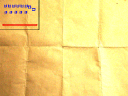

# Length Correction: Repeated Validation

Source checkpoint `c8fb3bd021c0be54e1749ce523377f128a62047d` corrects the
fixed-estimate Length/Normalize threshold. This directory retains independent
build identities, host sanitizer diagnostics, repeated ARM9 matrices, complete
interaction traces, and two deliberate negative controls.

The selected uninstrumented `perf` ROM is 814080 bytes, SHA-256
`f1961904a1a69501419ccb6330c804882fa1257627de3135ae1def99b7f1147f`.
Two independently built ROMs and complete ELFs match, as do the corrected
integration and ordinary runtime specimens; see
[direct/independent-builds.csv](direct/independent-builds.csv) and
[runtime/independent-builds.csv](runtime/independent-builds.csv).
Instrumented specimens have distinct hashes in their own `roms.txt` manifests.

## Arithmetic and Polygon Gates

[Host ASan/UBSan results](host/results.json) exhaust all 19662 nonnegative
component pairs whose raw L1 sum is 6552, 6553, or 6554. Reference and corrected
Length/Normalize APIs match exactly: zero failures, checksum `7805b4b1`.
The legacy API fails 6544 cases with actual checksum `b2c63575`. These positive
cases do not audit signed shifts or the full fixed-point range.

Every ordinary fixed-point runtime specimen also passes the same matrix using
ARM9 DIV/SQRT hardware. Floating-point specimens report zero fixed-point cases.
The [legacy threshold control](runtime/length-negative-control/) is rejected
for exactly 6544 failures. The [missing arithmetic-restore control](runtime/irq-negative-control/)
is rejected for all eight forced-preemption cases. After accounting for the
single intended failure, each control passes every remaining runtime gate.

The [polygon API comparison](polygon-api/assertions.txt) retains three runs per
specimen. The guarded ARM9 suite passes 16 cases with zero failures and checksum
`722c5bcb` in every run. Shared floating/fixed host controls and sanitizer
results are retained in [polygon-host/validation.json](polygon-host/validation.json).

## Direct Integration Comparison

The [12-run direct comparison](direct/assertions.txt) repeats all timing and
workload records exactly. The corrected improved ROM is newly built; historical,
floating-point modern, and fixed-point modern controls reuse their previously
verified byte identities. No reference control was silently replaced.

All 276 normalized records match the preceding
[matched-mode comparison](../matched-numeric-control/) after excluding only ROM
hash and size fields; see [baseline-comparison.json](direct/baseline-comparison.json).
Physics means remain 278893 historical, 584579 modern floating-point, 197213
modern fixed-point, and 110987 improved bus-counter ticks. The improved direct
sequence remains 556655 ticks. This sketch demonstrates no measured cost from
the correction. The recorded improved body states are unchanged; boundary
coverage comes from the separate exhaustive matrix. This is not a general
performance-benefit claim.

## Normal Application Loop

[All nine runtime runs](runtime/assertions.txt) repeat every metric and raw
trace exactly within each specimen. Each spans 960 VBlanks, creates and resets
the scene through GUI acquisition, renders both screens, drags a mouse joint,
deletes an object, and inserts its replacement.

| Specimen | Physics Steps | Physics Elapsed Mean | VBlank Handler Mean | Input Sample Age Mean | Unconsumed Samples |
| --- | ---: | ---: | ---: | ---: | ---: |
| Modern floating-point | 211 | 418097 | 50084 | 95053 | 45 |
| Modern fixed-point DS control | 252 | 108888 | 29061 | 58669 | 0 |
| Corrected improved | 252 | 56594 | 15212 | 31033 | 0 |

Times are DS bus-counter ticks. Different numerical modes and simulation-step
counts prevent an equivalent-work comparison with the floating-point control.
The schema-2 instrumentation and binary layout differ from the
[first runtime baseline](../runtime-loop-baseline/); runtime timing changes are
not attributed solely to the length correction.

The [trajectory comparison](runtime/trajectory-comparison.json) aligns the two
fixed-point roles by physics step and thing index. Of 3528 shared body records,
2374 differ; the first differences remain at step 26. The improved body's raw
state records also match its pre-correction baseline exactly. Correcting the
length API therefore does not explain this scene's cross-role divergence.
Complete manifolds, joint parameters, further profile isolation, and a declared
arithmetic contract remain outstanding.



This is the top-screen world overview: the scene occupies the upper-left third
because the world is three screen widths and heights. A supplemental
[capture-content check](runtime/capture-content.json) observes the red floor
and blue dynamic outlines in their expected projected regions in every run.
It establishes those features' presence, not pixel equivalence or visibility
of every individual edge. This is a final display-capture buffer, not
frame-by-frame visual equivalence.
The protocol injects ARM9 acquisition, not raw ARM7 resistive-touch latency, and
uses the modern audio compatibility path. No physical Nintendo DS result is
included.

## Reproduce

```sh
git checkout c8fb3bd021c0be54e1749ce523377f128a62047d
tools/repro/test_source_patches.sh
tools/repro/test_v06_perf.sh
REPEATS=3 tools/repro/test_v06_inrom.sh
REPEATS=3 tools/repro/test_polygon_api_inrom.sh
REPEATS=3 tools/repro/test_runtime_loop.sh
```

The preserved direct and polygon datasets reuse the previously identified
controls as disclosed above. The command rebuilds them from source. Keep their
source checkpoint, configuration snapshots, exit statuses, and identities with
any subsequent results. See the [threshold study](../../../docs/length-threshold-study.md)
and [normal-loop protocol](../../../docs/runtime-loop-study.md) for scope limits.
